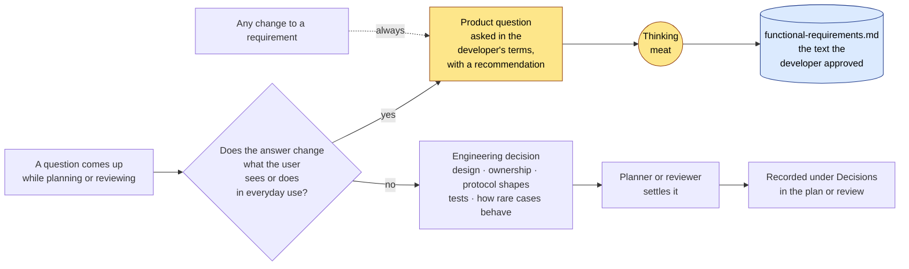
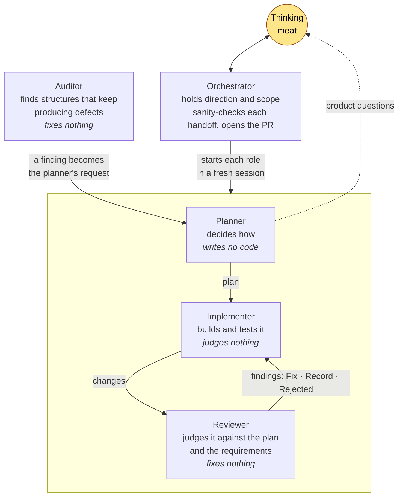
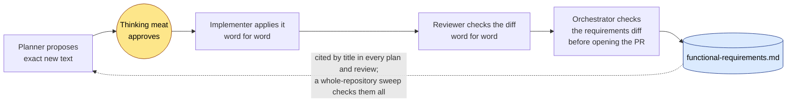
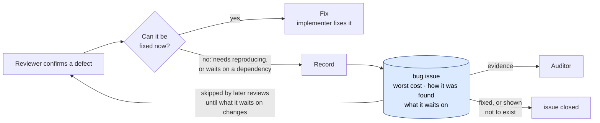
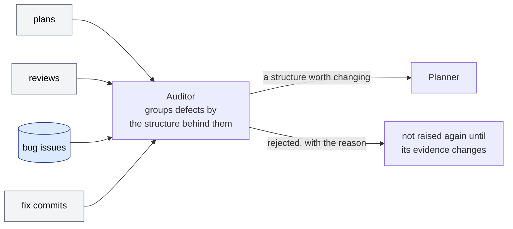

# Ox skills

The skills keep the decisions the developer has to make few and visible, keep each role
in its own context, and leave behind documents that say what the project is and does.
The step-by-step workflow is in [`AGENTS.md`](../../AGENTS.md#workflow).

## Who decides what

Every question a plan or review raises is sorted by one test: does the answer
change what the user sees or does in everyday use? Only those reach
the developer. The agents settle the rest and record why.

## Separate roles, separate contexts

Each role runs in its own session with fresh context. The implementer never
reviews its own work, and the reviewer never fixes what it finds, so every
change is judged by a session that did not write it. The orchestrator carries
the change between them and checks each handoff. A role may start child
sessions for parts of its own work, such as research, a disjoint part of the
implementation, or one area of a large review. The children report to the
role, which keeps every decision.

## What lasts

Plans, reviews, and audits are working records: each is committed with its
change and read later as evidence. The documents in `docs/` and the
repository's issues are what last. The documents say what the project does,
the issues what is known to be wrong with it, and every role reads them before
it starts.

### Functional requirements: what the user can rely on

`docs/functional-requirements.md` belongs to the developer. It holds only
behavior the user can see, and it changes only with text the developer
approved.

### Known issues: defects that cannot be fixed yet

Every confirmed defect is fixed, unless the fix waits on something the project
cannot change yet. Issues labeled `bug` keep those in view so they are neither
lost nor rediscovered by every review.

### Working records feed the audit

