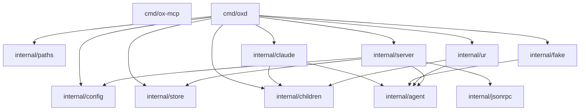

# Ox architecture

`oxd` keeps workspaces and agent sessions, runs their harnesses, and serves
clients over a Unix socket. `ox` serves the [web UI](#web-ui).

Each package of `oxd` depends only on the packages beneath it. The server and
each harness meet only at `internal/agent`; `cmd/oxd` gives the server each
harness by name, with its `Start` function and its prompt and configuration
checks.

| Package      | Owns                                                                                                                                                                                                                                                                                                                                                                                                                                                                                                                                                                                                                                                                                                                                                                                                   |
| ------------ | ------------------------------------------------------------------------------------------------------------------------------------------------------------------------------------------------------------------------------------------------------------------------------------------------------------------------------------------------------------------------------------------------------------------------------------------------------------------------------------------------------------------------------------------------------------------------------------------------------------------------------------------------------------------------------------------------------------------------------------------------------------------------------------------------------ |
| `cmd/ox-mcp` | Connecting a harness's MCP client, over stdio, to `oxd`'s socket for one session: attaching, then copying each line between stdin and the socket and the socket and stdout.                                                                                                                                                                                                                                                                                                                                                                                                                                                                                                                                                                                                                            |
| `cmd/oxd`    | Choosing the socket, database, and configuration, checking the configured harnesses, and holding the socket until sessions have stopped and every process in the `children` set has exited. A second stop signal kills every process in the set, including Claude processes still initializing and Ur commands, and ends the daemon.                                                                                                                                                                                                                                                                                                                                                                                                                                                                   |
| `paths`      | The XDG locations of the configuration, database, socket, and Ur's conversation directory, which `cmd/oxd` uses unless a flag overrides them and `cmd/ox` uses for the socket.                                                                                                                                                                                                                                                                                                                                                                                                                                                                                                                                                                                                                         |
| `config`     | Writing the built-in default to a missing configuration file, reading the file into each harness's models, efforts, and permission modes and the new-session defaults, and checking settings against them.                                                                                                                                                                                                                                                                                                                                                                                                                                                                                                                                                                                             |
| `server`     | Client and MCP connections, each session's goroutine and the agent it runs, and the mapping from each method to a session operation and its error codes. Each connection writes through its own queue, so sessions never wait on a client.                                                                                                                                                                                                                                                                                                                                                                                                                                                                                                                                                             |
| `store`      | The SQLite database of workspaces, sessions, child sessions' `children` rows, archived sessions' `archived` rows, and session events, held exclusively through a lock file beside it from opening to closing.                                                                                                                                                                                                                                                                                                                                                                                                                                                                                                                                                                                          |
| `jsonrpc`    | Request validation and the response and notification types.                                                                                                                                                                                                                                                                                                                                                                                                                                                                                                                                                                                                                                                                                                                                            |
| `agent`      | The `Agent` interface a harness implements, its `Start` function, prompt and configuration checks, and options, and the updates, snapshots, settings, and errors they share.                                                                                                                                                                                                                                                                                                                                                                                                                                                                                                                                                                                                                           |
| `fake`       | A harness that runs no process and echoes each prompt back, a word at a time. A prompt `approve <tool> <input JSON>` first asks to approve that tool call, and the call's result is the answer. A prompt `background <milliseconds>` also runs a background task that long.                                                                                                                                                                                                                                                                                                                                                                                                                                                                                                                            |
| `ur`         | A harness that streams each turn from OpenRouter chat completions requests and checks each shell call's arguments once, so the transcript, the approval card, and the command are one value, and runs the call in the session's workspace, in its own process group registered with `children`, which ends with the call or its turn. It appends each prompt, each reply delta as it streams, each response's tool calls, and each finished call's outcome to the JSONL file named by its resume token, reconstructs an interrupted call's outcome when it reads the file back to resume, and reports itself parkable when idle. Each request starts with a system message built from the workspace, the OS, the date, and the workspace's `AGENTS.md`, which is never saved to the conversation file. |
| `children`   | The set of processes `oxd` waits for before exiting and kills on a second stop signal: a process joins it when a harness starts it and leaves it once reaped, and none starts once the set has been killed.                                                                                                                                                                                                                                                                                                                                                                                                                                                                                                                                                                                            |
| `claude`     | The Claude Code harness: starting and initializing Claude, its stream-json wire format, and the state machine that runs it as an `Agent`.                                                                                                                                                                                                                                                                                                                                                                                                                                                                                                                                                                                                                                                              |

## Sessions

The server loads the stored workspaces and sessions at startup, all parked. A
session's ID is Ox's own. The session stores the harness's conversation token
when it receives `OnResumable` and supplies it at later starts. An empty token
from `OnResumable` clears it, so the next start begins a new conversation. See
the [session lifecycle](protocol.md#workspaces-and-sessions) for client
behavior.

Each session runs on its own goroutine, which owns its settings, resume token,
history, agent, and park timer. Every request that reads or changes that state,
archive included, is an operation posted to that goroutine, and the agent's
events and the park timer are handled there between operations. An operation
queues its own response there: at once; for a configuration Claude must
acknowledge, from the event that finishes it; and for an archive, once every
member has stopped. Unarchive changes only state `Server.mu` guards and is not
posted to a goroutine. Nothing else touches a session's state, and a response
lands in a connection's queue after every update it reflects and before every
update it does not. The server handles each connection's requests on separate
goroutines. Workspace and session membership changes are stored before they are
applied in memory. The session keeps the settings it adopts and the resume token
it receives or clears even when storing them fails.

`Server.mu` guards workspace and session membership, each session's archived
flag, and the shutdown flag. Membership and archive changes and `workspace/list`
queue their messages under the same lock so every connection sees them in one
order. Unarchive looks its session up and queues its response under the lock.
Nothing posts to a session, launches a harness, or hands an agent input while
holding it.

An archived session has no agent, and a child of an archived session is
archived. An archive runs on the session's goroutine. It holds every session
beneath it, breadth-first, each with an operation that reports whether the
session is idle, in the background, or parked and then waits. Each member is
held before its children are read, which fixes them, since they are created only
on its goroutine; an archive posts only from an ancestor to its descendants, so
two archives in one family cannot deadlock. With every member free, the archive
stores and sets the flags under `Server.mu`, stops its own agent, and releases
the members, which stop theirs, and replies once each has stopped; otherwise it
releases them unchanged. Unarchiving, in one critical section under `Server.mu`,
looks the session up by ID, refuses a child whose parent is archived, clears the
flags of the session and every session beneath it, and queues its response. The
one place an input starts a parked session refuses an archived one, and so does
`create_session` for an archived caller.

The session writes each conversation event to the store as it arrives. See
[the snapshot and history contract](protocol.md#sessionget).

The agent owns every input it has not taken, user prompts and messages alike,
with their IDs, text, and attribution, from acceptance until each is taken or
dropped. The session hands it each input as it arrives, starting a parked
session first, and refuses a user prompt while the agent reports any input
untaken. `send_message` posts to the recipient's goroutine and `list_sessions`
captures each entry on its owning goroutine. `read_session` reads the target's
snapshot and history on the target's goroutine and starts nothing. Only
archiving posts from one session goroutine to another: the archived session's
goroutine holds each descendant's goroutine, ancestors first, until the archive
ends.

A child session holds a `child` value, fixed at creation and stored in the same
transaction as its session row, naming its parent, name, title, and directory; a
top-level session has none. The directory its harness runs in is derived: the
child's directory, else the workspace's. `create_session` checks its arguments
on the call goroutine, then posts to the parent's goroutine, which resolves the
child's settings from its own. Under `Server.mu` it checks name uniqueness,
archive, and depth; without the lock it stores the child and launches its
harness; under `Server.mu` again it refuses if the daemon is shutting down,
stopping the agent and deleting the row, and otherwise adds the child to
membership; then it hands the child's agent the first message and starts its
goroutine. A request posted to the child waits until then. A harness that cannot
be launched leaves the child unstored and unpublished. A session belongs to
whoever builds it until its goroutine starts. A session's destroy operation
refuses while any session is its child; since children are created only on the
parent's goroutine, none appears while it runs.

The session arms a park timer whenever its agent is `Parkable` and stops it when
the agent stops being parkable, so the full period restarts each time. If the
timer fires, the session stops the agent, which ends at once while its process
exits in the background.

## Agents

An `Agent` runs one harness instance. `Start` returns at once with the agent
starting, and fails only when the harness cannot be launched; a start that fails
later ends the agent with its reason. `Stop` ends the agent at once. The session
goroutine drives it by calling its methods and passing each event from `Events`
to `Handle`. The agent publishes through `OnUpdate` during those calls, and
reports failures no call returns, such as a failed write to its process, through
`OnError`, which the session logs under its ID. `Send` receives the input with
its session-assigned ID, text, and attribution, and queues it behind every input
the harness has not taken. The harness decides when an input is written, taken,
or dropped, and records each take and drop, with its own reported execution
state, in an `agent.Tracker`. The tracker keeps the untaken inputs, oldest
first, and publishes their lifecycle updates with the input's text and
attribution. It derives the published state: the harness's report, except that
an idle harness is `running` while any input is untaken, and otherwise
`background` while background tasks run. `Snapshot` reports both from the
tracker. The agent reports settings changes through `OnConfigured`, as they
happen, separately from the outcome of a `Configure` request. See the
[update contract](protocol.md#session-updates).

Each harness receives Ox's MCP server for its session: the `ox-mcp` beside
`oxd`, its environment naming the socket and the session, and the tools that run
without an approval prompt where the permission mode allows.

### The Claude agent

Ox assigns a fresh UUID when launching a new Claude conversation. The agent
tracks the conversation ID Claude reports and calls `OnResumable` once a changed
ID is known to be resumable. See Claude's
[transcript timing](harnesses/claude-code.md#session-ids). On every launch,
resumes included, it registers Ox's MCP server as `ox` and pre-approves its
tools; see Claude's [launch flags](harnesses/claude-code.md#persistent-session).

One stdout reader, from spawn to exit, drains the pipe into a delivery queue
independently of the session, delivering each JSON line and each other nonblank
line as plain text. The reader's inherited-descriptor cutoff does not limit
delivery; all captured output arrives before the exit event, which includes the
stderr tail. Once the agent has ended, delivery discards the rest. The output
queue, the startup limit, and control-request timers deliver through `Events`.
The session publishes updates in the order it handles operations and events.

The phase identifies the current operation and holds the fields valid only
during it:

| Phase         | Meaning                                                                                                                                          | Leaves on                                                                               |
| ------------- | ------------------------------------------------------------------------------------------------------------------------------------------------ | --------------------------------------------------------------------------------------- |
| `starting`    | Claude has not answered `initialize`. It holds Claude's last failure output; inputs sent meanwhile wait unwritten.                               | The `initialize` response, a refusal, the startup limit, the process's exit, or `Stop`. |
| `available`   | Available for a prompt or configuration, with no input untaken.                                                                                  | A prompt or configuration starts.                                                       |
| `prompting`   | Client prompts hold the agent. The first untaken input, if any, has been written, and `command_lifecycle started` or `cancelled` for it ends it. | Claude reports `idle` with no input untaken.                                            |
| `configuring` | Control requests are in flight, one at a time; inputs sent meanwhile wait unwritten.                                                             | The last acknowledgement, a refusal, a write failure, or a timeout.                     |
| `timedOut`    | A control request went unanswered and Ox asked the process to exit.                                                                              | The process exits.                                                                      |
| `exited`      | The agent has ended.                                                                                                                             | —                                                                                       |

The process's exit, `Stop`, or a failed start moves any live phase to `exited`,
dropping every untaken input. Alongside the phase, the agent's tracker keeps
Claude's last reported execution state and the count of background tasks Claude
reports.

The agent writes only the first untaken input. An input is written at once in
`available`, or in `prompting` when nothing is untaken; otherwise it waits. When
Claude answers `initialize`, a configuration ends, or Claude takes or drops the
written input, the agent writes the next. Both `available` and an `idle` or
`background` published state are required to take a configuration. An interrupt
drops every input not yet written; in `available` or `prompting` with the
published state not `idle` or `background` it is then sent to Claude, dropping
the written input Claude has not taken. In `starting`, `configuring`, and
`timedOut` it sends nothing.

The agent derives `Parkable` from its phase, its state, pending approvals, and
[Claude's reports of background work](harnesses/claude-code.md#8-background-work-and-schedules).
On resume or after a scheduling tool call, only a Stop report with an empty
schedule list clears the possible pending work. See the
[parking rule](protocol.md#workspaces-and-sessions).

## Web UI

The web UI in `cmd/ox/web` is a Solid 2.0 app written in TypeScript. `make web`
builds it with Vite into `cmd/ox/web/dist`, which `ox` embeds, and `make build`
builds it before the binaries. `make dev` runs `oxd` and `ox`, which serves the
UI at http://localhost:8080. Enter in the `make dev` terminal rebuilds the web
client and the binaries and restarts `ox` or `oxd` if its binary changed. In a
linked worktree, `make dev` keeps its configuration, state, and socket under the
checkout's `.state`, serves on a free port, and prints the page's URL.

Each page gets an `oxd` connection through `ox`: `/events` relays socket lines
as Server-Sent Events, and `/rpc` posts the page's JSON-RPC requests to the
socket. Its 8 MiB request body cap leaves space for JSON escaping under the
[decoded prompt limit](protocol.md#sessionsend). `ox` answers both only when the
request's `Host` names `localhost`, `127.0.0.1`, `[::1]`, the host given to
`-addr`, or the configured [`tailscale_ip`](protocol.md#configuration), and
refuses an `/rpc` post from another origin, so a page whose domain rebinds to
one of these addresses cannot reach `oxd`. `/rpc` answers `503` when the page's
`oxd` connection is gone, and the page treats it as a lost connection.

When the configuration sets `tailscale_ip`, `ox` also binds that address at port
17840, alongside the listener at `-addr`, and prints the tailnet URL once both
have bound; both listeners serve the same relay and UI.

| File                                                                                                                                                                                            | Owns                                                                                                                                                                                                                                                                       |
| ----------------------------------------------------------------------------------------------------------------------------------------------------------------------------------------------- | -------------------------------------------------------------------------------------------------------------------------------------------------------------------------------------------------------------------------------------------------------------------------- |
| `protocol.ts`                                                                                                                                                                                   | Types for the `oxd` methods, updates, and notifications.                                                                                                                                                                                                                   |
| `connection.ts`                                                                                                                                                                                 | Opening the event stream, sending requests, matching replies, and reporting stream errors.                                                                                                                                                                                 |
| `ox.tsx`                                                                                                                                                                                        | A provider that reloads the catalog, workspaces, and sessions on each connection, updating loaded sessions in place so their views keep their state, applies notifications, and exposes RPC calls; each session's control; `createAttempt`, which shows a request's error. |
| `viewport.ts`                                                                                                                                                                                   | Sizing the page to the browser's visible area for the life of the page.                                                                                                                                                                                                    |
| `poll.ts`                                                                                                                                                                                       | The page's polling: a request repeated on each tick of the provider's clock, one in flight at a time.                                                                                                                                                                      |
| `highlight.ts`                                                                                                                                                                                  | Syntax highlighting: the registered languages and the file names that choose them.                                                                                                                                                                                         |
| `toolInput.ts`                                                                                                                                                                                  | Readers of Claude's tool calls: a call's label, its subject, an `ExitPlanMode` plan, `AskUserQuestion` questions, and a call's input as JSON.                                                                                                                              |
| `App.tsx`, `Panels.tsx`, `Sidebar.tsx`, `SessionView.tsx`, `NewSessionView.tsx`, `FileTree.tsx`, `FileView.tsx`, `ApprovalRequest.tsx`, `SettingsFields.tsx`, `HarnessIcon.tsx`, `Markdown.tsx` | The components. `Layout` in `App.tsx` owns the page's panels for the life of the page: which show and their widths in the wide layout, and which drawer is open in the narrow one, below 768 px.                                                                           |

The page shows stream errors while reconnecting and asks for a reload if the
browser closes the stream after `ox` refuses it. A request that cannot reach the
relay drops the connection as a stream error does, and the page reconnects. A
reload request that fails while the stream is connected repeats each second, and
its failure shows as the page error until it is answered.

A session's control owns the page's requests for that session: its composer
text, the folders its file tree has expanded, its open file and the split
between the transcript and the file viewer, creation, sends, configuration,
interrupts, approval answers, and their errors. It outlives the session's view,
so leaving the view or reconnecting keeps the text, expanded folders, open file,
and split and repeats no request. A send and a configuration exclude each other.
The control remembers the prompt it sent last, so a prompt dropped before Claude
took it returns to the composer of the page that sent it. The settings form
sends a patch to [`session/configure`](protocol.md#sessionconfigure) and shows
the requested values, each changed one with a spinner, and Send disabled until
the request settles. After a reconnect each session waits for its own snapshot
before allowing another send or settings change.

The page keeps one draft per workspace. Its ID and composer carry over to the
created session. A successful create sends the submitted text once. If the reply
is lost, the page can recognize the session after reconnect, restore its
composer and let the user decide when to send. A failed creation in another view
links back to the draft.

The file tree lists each folder it shows with
[`workspace/list_folder`](protocol.md#workspacelist_folder): the workspace's
directory, and each expanded folder that its parent's latest listing contains.
Each folder lists itself when it appears and again once a second while the page
is visible and connected, with one request in flight at a time.

The file viewer reads the control's open file with
[`workspace/read_file`](protocol.md#workspaceread_file) on the same clock as the
tree. Its view is keyed by workspace and path, so its text is always the open
file's.
