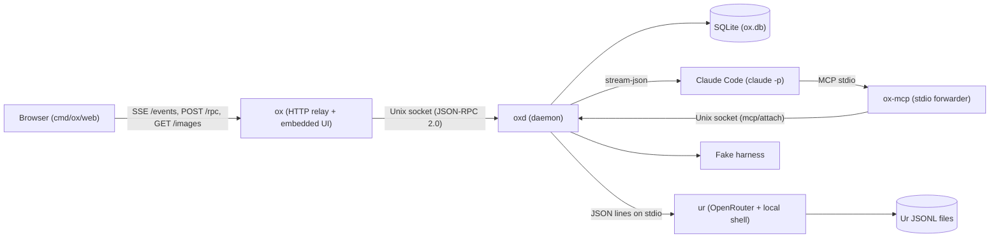
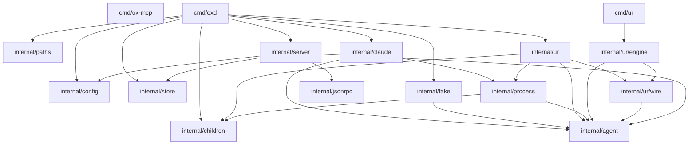
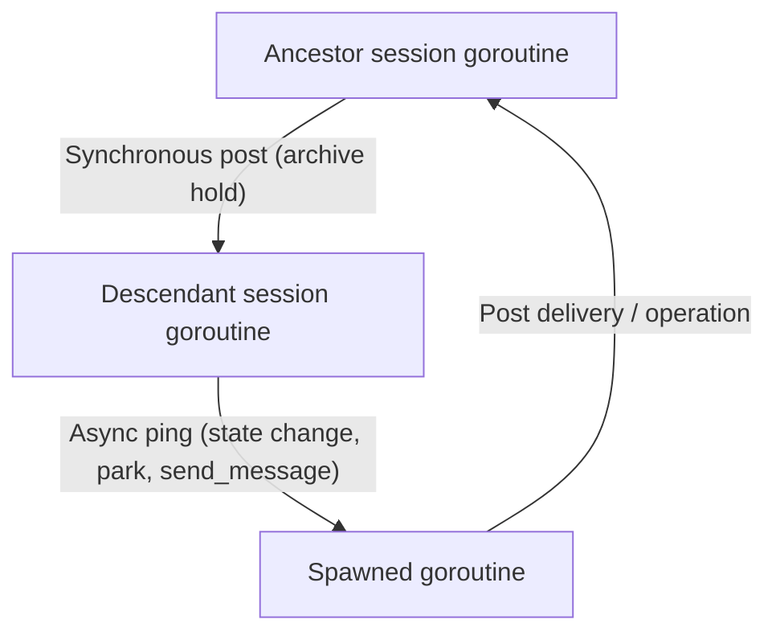
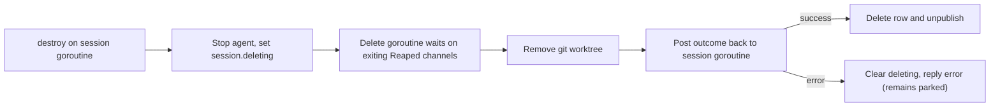
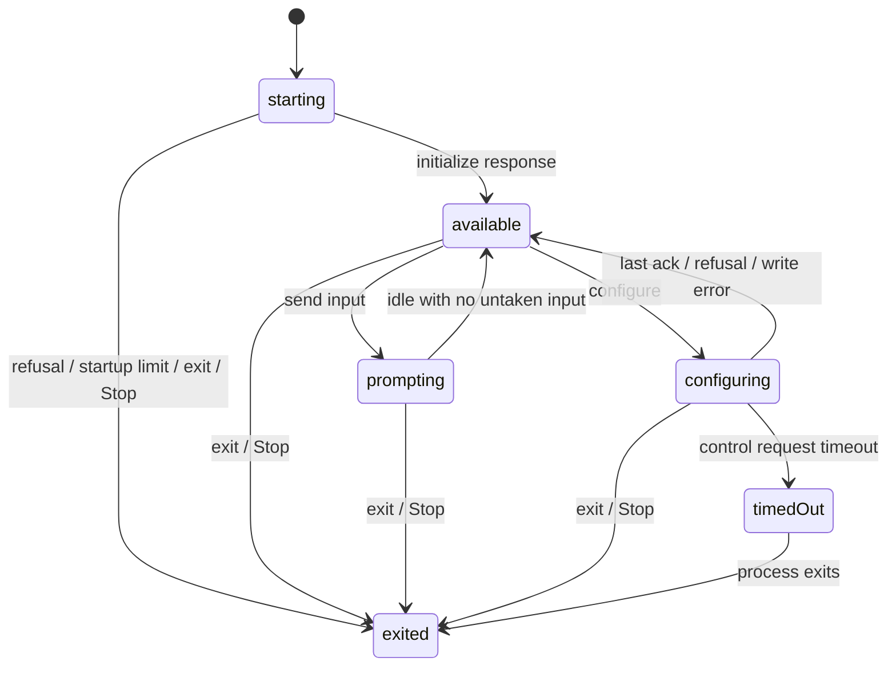

# Ox architecture

`oxd` keeps workspaces and agent sessions, runs their harnesses, and serves
clients over a Unix socket. `ox` serves the [web UI](#web-ui).

## Runtime overview

## Packages

Each package of `oxd` depends only on the packages beneath it. The server and
each harness meet only at `internal/agent`; `cmd/oxd` gives the server each
harness by name, with its `Start` function and its prompt and configuration
checks. `cmd/ur` is its own program: `oxd` links only Ur's harness and the wire
protocol it shares with `ur`.

| Package      | Owns                                                                                                                                                                                                                    |
| ------------ | ----------------------------------------------------------------------------------------------------------------------------------------------------------------------------------------------------------------------- |
| `cmd/ox-mcp` | Bridging a harness's stdio MCP client to `oxd`'s socket for one session: attaching, then copying lines in both directions.                                                                                              |
| `cmd/ur`     | Running the `ur` program, which `oxd` starts for each running Ur session and for each one-shot Ur request.                                                                                                              |
| `cmd/oxd`    | Resolving socket, database, and config paths, checking configured harnesses, and holding the socket until sessions stop and every process in `children` exits. A second stop signal kills `children` and exits at once. |
| `paths`      | XDG locations of the configuration, database, socket, Ur conversation directory, and session worktrees (`cmd/oxd` flags can override them; `cmd/ox` uses `paths` for the socket and config).                            |
| `config`     | Writing the built-in default to a missing config file, loading each harness's models, efforts, permission modes, defaults, and titling model, and validating settings against them.                                     |
| `server`     | Client and MCP connections, each session's goroutine and agent, method dispatch, and error codes. Each connection writes through its own queue so sessions never wait on a client.                                      |
| `store`      | SQLite database of workspaces, sessions, `children`, `worktrees`, `archived`, session events, and prompt images, held exclusively through an adjacent lock file from open to close.                                     |
| `jsonrpc`    | Request validation and the response and notification types.                                                                                                                                                             |
| `agent`      | The `Agent` interface, `Start` and one-shot `Ask` functions, prompt and config checks, options, and shared updates, snapshots, settings, and errors.                                                                    |
| `children`   | The set of child processes `oxd` waits for on shutdown and kills on a second stop signal. A process joins on start and leaves once reaped; none can start after the set is killed.                                      |
| `process`    | A harness process on pipes `oxd` owns: each stdout line delivered as an event without blocking the reader, stderr logged with its tail kept, and the exit delivered after the last line.                                |
| `claude`     | The Claude Code harness: launching and initializing `claude`, its stream-json wire format, and its `Agent` state machine.                                                                                               |
| `ur`         | Ur's harness in `oxd`: starting `ur` and adapting its reports to an `Agent`, and running `ur -ask`.                                                                                                                     |
| `ur/wire`    | The line protocol between `oxd` and `ur`: commands on `ur`'s stdin and events on its stdout.                                                                                                                            |
| `ur/engine`  | The `ur` program: streaming chat completions, shell command execution, and JSONL conversation persistence.                                                                                                              |
| `fake`       | In-process echo harness used by tests, and scene player for the README's screenshots.                                                                                                                                   |

## Sessions

### State ownership and locking

Session state is split strictly between `Server.mu` and per-session goroutines.
Each connection handles incoming requests on separate goroutines, and each
connection writes through its own queue.

| Owner             | Owns                                                                                                                                             | Access rule                                                                                                                                                                                                                                                                                                         |
| ----------------- | ------------------------------------------------------------------------------------------------------------------------------------------------ | ------------------------------------------------------------------------------------------------------------------------------------------------------------------------------------------------------------------------------------------------------------------------------------------------------------------- |
| `Server.mu`       | Workspace and session membership, children's untaken reports and `toParent`, archived flags, shutdown flag, and admission to `Server.creations`. | Membership and archive changes and `workspace/list` queue messages under this lock so every connection sees one order. Never held while posting to a session, launching a harness, running git, or handing input to an agent.                                                                                       |
| Session goroutine | Settings, resume token, history, active agent, park timer, a child's step and accepted `send_message` IDs, `exiting`, and `deleting`.            | Every request reading or changing this state (including archive) posts an operation here. Responses are queued from here—at once, on the finishing event for Claude config changes, or after all members stop for archive—so each response lands strictly after updates it reflects and before updates it does not. |
| Unarchive         | Archived flags only (under `Server.mu`).                                                                                                         | Looks up the session, refuses a child with an archived parent, clears flags across its subtree, and queues its response in one critical section without posting to a goroutine.                                                                                                                                     |

Synchronous waits between session goroutines flow in one direction only, so
cycles cannot happen:

- Every chain of synchronous waits ends at a leaf.
- A descendant reaches an ancestor only through a goroutine of its own.

### Lifecycle, persistence, and parking

- **Startup:** `oxd` loads stored workspaces and sessions at startup, all
  parked. Every session has an Ox-assigned ID and a `directory` fixed at
  creation (its workspace's path, its worktree copy, or the directory
  `create_session` resolved for a child).
- **Resume tokens:** The session saves the harness's conversation token on
  `OnResumable` and passes it on later starts. An empty token clears it so the
  next start begins a fresh conversation. See the
  [session lifecycle](protocol.md#workspaces-and-sessions).
- **Persistence order:** Workspace and session membership changes are stored
  before being applied in memory. Each conversation event is written to the
  store as it arrives; see
  [the snapshot and history contract](protocol.md#sessionget). A session keeps
  adopted settings and updated or cleared resume tokens in memory even if
  storing them fails.
- **Input acceptance:** The agent owns every untaken input (user prompts and
  messages) with its ID, text, and attribution until taken or dropped. The
  session hands inputs to the agent as they arrive, starting a parked session
  first, and refuses a user prompt while any input is untaken.
- **Inter-session reads and messages:** `send_message` posts to the recipient's
  goroutine, `list_sessions` captures each entry on its owning goroutine, and
  `read_session` reads the target's snapshot and history on its goroutine
  without starting it.
- **Parking:** The session arms its park timer whenever the agent is `Parkable`
  and stops it when it ceases to be `Parkable`, restarting the full period each
  time. Firing the timer stops the agent at once while its process exits in the
  background.

### Archiving

An archived session has no running agent, and every child of an archived session
is archived.

1. Archive runs on the target session's goroutine and walks descendants
   breadth-first.
2. It posts a hold operation to each descendant (ancestor before children, so no
   new children can be created on a held parent). Each member reports whether it
   is parked or its agent is idle, which the harness answers from its own state,
   counting a configuration in progress as busy, then waits.
3. If every member is free, archive stores and sets the archived flags under
   `Server.mu`, stops its own agent, releases the descendants to stop theirs,
   and replies once every member has stopped. Otherwise it releases them
   unchanged.
4. Two concurrent archives in the same family cannot deadlock because holds
   travel strictly from ancestor to descendant.

The single path that starts a parked session on input refuses archived sessions,
and `create_session` refuses an archived caller.

### Child sessions and reports

A child session holds an immutable `child` value (parent, name, title) stored in
the same transaction as its session row; top-level sessions have none.

**Creation flow (`create_session`):**

1. Validate arguments on the call goroutine, then post to the parent's goroutine
   to resolve inherited settings.
2. Under `Server.mu`, check name uniqueness, archive state, and depth.
3. Without the lock, store the child row and launch its harness (a launch
   failure leaves the child unstored and unpublished).
4. Under `Server.mu`, abort (stopping the agent and deleting the row) if `oxd`
   is shutting down; otherwise publish the child into membership.
5. Hand the child's agent its first message and start its goroutine (requests
   posted to the child wait until then).

A session belongs to its builder until its goroutine starts. Destroying a
session refuses while it has any children; because children are created only on
the parent's goroutine, none can appear during destroy.

**Child turn reports:**

A child is in its family while it has a `toParent`, which a delete clears before
it stops the child. `toParent` holds the child's untaken reports, guarded by
`Server.mu` beside its published state, and, owned by the child's goroutine, the
`tool_use` IDs of the turn's latest step and of the `send_message` calls to the
parent that the parent accepted. When the parent accepts such a call, the call
posts its `tool_use` ID, from the request's `_meta`, to the child and answers
from there, so the mark precedes the call's `tool_result`.

- On `result`: the child keeps a report unless an accepted call's ID is in the
  step, then clears the step and the accepted IDs.
- On `exited`: the child always keeps a report and clears them.
- **Delivery:** `readyLocked` decides, from facts `Server.mu` guards, whether a
  parent takes its reports: `oxd` is not shutting down, the parent is not
  archived and is `idle`, `background`, or `parked`, no child in the family is
  `running`, and some child holds a report. Every writer of those facts (a
  published state, a report, an archived flag, a delete leaving the family)
  calls `familyChangedLocked` in the same critical section, which posts a
  delivery to the parent when `readyLocked` holds. The delivery runs on the
  parent's goroutine, checks `readyLocked` again and takes the reports in one
  critical section, and after releasing the lock hands them to the parent's
  agent as one message. Queued messages go first because a ready session has no
  untaken input.
- An ending harness drops its untaken inputs without publishing a state, so a
  child goes from its last state to `parked` with its exit report already kept.

### Worktrees

A top-level session created with `worktree` stores its worktree root in a
`worktrees` row written with its session row and fixed at creation (the store
refuses worktrees for children). Ownership comes from that row, so changing the
configured worktrees directory leaves existing worktrees owned. Branch, `HEAD`,
cleanliness, and registration are read live via `server/worktree.go` with stdin
closed and git's stderr surfaced as the error.

**Creation (git never runs under `Server.mu`):**

1. Under `Server.mu`, run normal creation checks and register in
   `Server.creations`.
2. Without the lock, create the git worktree under a fresh name on a matching
   branch with hooks disabled, and verify the workspace's copy exists inside it.
3. Under `Server.mu`, refuse if shutting down or the workspace is gone, return
   the existing session if the same ID appeared meanwhile, or store and publish
   the session.

Publication is the sole ownership transfer from the request to the session; any
other outcome force-removes the worktree and branch before replying. `Close`
sets the shutdown flag (blocking new creations), waits for sessions, and then
waits for `Server.creations`. A second stop signal exits immediately and can
leave an in-progress checkout behind (logged with its session ID).

**Ownership:** `Server.worktreeOwnerLocked` maps a physical path to its owning
worktree session. `workspace/create` refuses any path it owns, and
`create_session` refuses a `dir` (resolved physically on the call goroutine)
owned by a session other than the caller's top-level ancestor. Only the owner
and its descendants can run there, and the owner cannot be deleted until its
descendants are gone.

**Deletion and process reaping:**

- `Agent.Reaped` closes once every process the agent started has exited (Claude
  reaped by its reader; `ur` reaped by its reader once it has killed and reaped
  its commands' process groups). Every dropped agent passes through
  `session.parked`, which appends its `Reaped` channel to `session.exiting` and
  prunes closed ones.
- While `session.deleting` is set, the session keeps answering unrelated
  operations while refusing starts, child starts, and a second destroy. If
  shutdown ends the goroutine first, the delete goroutine replies that `oxd` is
  shutting down.
- Worktree removal checks registration and directory presence live (running git
  in the worktree if present, otherwise in the workspace), so retrying a partial
  delete or deleting after the workspace folder vanished still succeeds.
- Claude ends its Bash tool processes on `SIGTERM`; a Claude killed after the
  ten-second limit can leave tool processes running in their own sessions that
  Ox cannot reach. Starting a session refuses a missing directory.

## Agents

An `Agent` runs one harness instance. `Start` returns immediately in a starting
state and fails only if the harness cannot launch; later startup failures end
the agent with a reason. `Stop` ends the agent at once.

- **Event loop:** The session goroutine drives the agent by calling its methods
  and passing each event from `Events` to `Handle`. The agent publishes updates
  via `OnUpdate` during those calls, reports asynchronous errors (such as a
  failed write) via `OnError` (logged with the session ID), and reports adopted
  settings changes via `OnConfigured` separately from `Configure` replies. See
  the [update contract](protocol.md#session-updates).
- **Input and state tracking (`agent.Tracker`):** `Send` queues an input (with
  its session-assigned ID, text, and attribution) behind untaken inputs. The
  harness decides when each input is written, taken, or dropped, recording each
  transition and its reported execution state in `agent.Tracker`. The tracker
  publishes input lifecycle updates and derives the published state: an idle
  harness publishes `running` while any input is untaken, `background` while
  background tasks run, and its own reported state otherwise. `Snapshot` reads
  both from the tracker.
- **MCP server:** Each harness receives Ox's MCP server for its session—the
  `ox-mcp` binary beside `oxd`, environment naming the socket and session, and
  the tools allowed without an approval prompt where the permission mode
  permits.

### The Claude agent

The Claude agent runs an explicit phase state machine alongside `agent.Tracker`
(which holds Claude's last reported execution state and background task count):

| Phase         | Meaning                                                                                                                               | Leaves on                                                               |
| ------------- | ------------------------------------------------------------------------------------------------------------------------------------- | ----------------------------------------------------------------------- |
| `starting`    | Claude has not answered `initialize`. Holds Claude's last failure output; inputs sent meanwhile wait unwritten.                       | `initialize` response, refusal, startup limit, process exit, or `Stop`. |
| `available`   | Ready for a prompt or configuration, with no input untaken.                                                                           | Prompt or configuration starts.                                         |
| `prompting`   | Client prompts hold the agent. The first untaken input, if any, has been written; `command_lifecycle started` or `cancelled` ends it. | Claude reports `idle` with no input untaken.                            |
| `configuring` | Control requests are in flight, one at a time; inputs sent meanwhile wait unwritten.                                                  | Last acknowledgement, refusal, write failure, or timeout.               |
| `timedOut`    | A control request went unanswered and Ox asked the process to exit.                                                                   | Process exits.                                                          |
| `exited`      | The agent has ended (any transition here drops all untaken inputs).                                                                   | —                                                                       |

- **Launch and resume:** Ox assigns a fresh UUID for a new Claude conversation,
  tracks the conversation ID Claude reports, and calls `OnResumable` once a
  changed ID is known to be resumable (see
  [transcript timing](harnesses/claude-code.md#session-ids)). Every launch
  registers `ox-mcp` as `ox` and pre-approves its tools (see
  [launch flags](harnesses/claude-code.md#persistent-session)).
- **Output reader:** One stdout reader runs from spawn to exit, draining the
  pipe into an independent delivery queue. Each JSON line and each other
  nonblank line (as plain text) is delivered before the exit event (which
  carries the stderr tail), unaffected by inherited-descriptor cutoffs. Output
  after the agent ends is discarded. The output queue, startup limit, and
  control-request timers all deliver through `Events`, and the session publishes
  updates in handling order.
- **Writing inputs and configuring:** The agent writes only the first untaken
  input—immediately in `available`, or in `prompting` when nothing is untaken;
  otherwise it waits until `initialize` completes, a configuration ends, or
  Claude takes or drops the written input. Taking a `Configure` request requires
  both `available` and a published state of `idle` or `background`.
- **Interrupts:** Drops every unwritten input. In `starting`, `available`,
  `prompting`, or `configuring` when published state is neither `idle` nor
  `background`, it sends an interrupt to Claude and drops the written untaken
  input. In `timedOut`, it sends nothing. The interrupt's reply waits until
  Claude reports `idle`, Claude takes an input other than the one written when
  the interrupt was sent, or the agent ends.
- **Parking:** `Parkable` is derived from phase, state, pending approvals, and
  [Claude's reports of background work](harnesses/claude-code.md#8-background-work-and-schedules).
  On a resume whose history has a `CronCreate` call, or after a scheduling tool
  call, only a Stop report with an empty schedule list clears possible pending
  work. See the [parking rule](protocol.md#workspaces-and-sessions).

### The Ur agent

`oxd` starts one `ur` process per running Ur session, in the session's
directory, with the session's settings as flags, and drives it with one JSON
object per line each way ([`internal/ur/wire`](../internal/ur/wire/wire.go)):
`oxd` writes inputs, approval answers, interrupts, and settings, and `ur`
reports each input it takes or drops, its state, transcript updates, its resume
token, each interrupt it has carried out, and each command's process group as it
starts and once it is killed.

The `ur` process:

- Streams each turn from OpenRouter chat completions with an ephemeral system
  message built from the workspace, OS, date, and the workspace's `AGENTS.md`
  (never written to the conversation file).
- Validates each shell call's arguments once, so the transcript, approval card,
  and executed command share one value.
- Runs each shell call in the session's workspace inside its own process group,
  ending with the call or its turn.
- Appends prompts, streamed reply deltas, tool calls, and finished outcomes to
  the JSONL file named by its resume token, reconstructing an interrupted call's
  outcome when resuming.
- Stops when its stdin ends or on `SIGTERM`, which `children.KillAll` also
  sends: it ends the turn, kills its commands' process groups, and exits once
  they are reaped. It ignores `SIGINT`.

The adapter in `internal/ur` keeps the inputs written and not yet reported taken
or dropped, the pending approvals, the running turn's input, the interrupts
written and not yet carried out, and the process groups of `ur`'s running
commands. It is the one place that tags and times Ur's updates. It reports
`Parkable` when idle, and ends the agent when `ur` exits, reports the
conversation lost, or breaks the protocol. When `ur` exits, it first kills the
process groups `ur` left running.

### The Fake agent

Runs no external process and echoes each prompt back (in at most four runs of
words) with its image count. Recognizes these test prompts:

| Prompt                        | Behavior                                                                       |
| ----------------------------- | ------------------------------------------------------------------------------ |
| `approve <tool> <input JSON>` | Requests approval for that tool call; returns the user's answer as the result. |
| `background <milliseconds>`   | Runs a background task for that duration alongside the turn.                   |
| `wait <milliseconds>`         | Keeps the turn running for that duration before replying.                      |
| `think <text>`                | Streams the text as reasoning before the reply.                                |
| `usage`                       | Reports a 5-hour and a 7-day usage window before the reply.                    |
| `usage reset`                 | Reports the same windows with the 5-hour window already reset.                 |

Its scripted mode plays a scene's turns in place of a model: each session's
first input binds it to the scene session whose prompt or message it holds, and
each input plays that session's next turn. `oxd` built with `-tags screenshots`
runs the scripted mode as `claude` and `ur`, playing the scene file named by
`-scene`.

## Web UI

The web UI in `cmd/ox/web` is a Solid 2.0 TypeScript app built with Vite into
`cmd/ox/web/dist` (`make web`) and embedded in `ox` (`make build`).

`make dev` runs `oxd` and `ox` together at `http://localhost:8080`; pressing
Enter, or `make restart`, rebuilds the web client and binaries and restarts
whichever binary changed. In a linked worktree, `make dev` keeps its config,
state, and socket under `.state`, serves on a free port, and prints the URL.

### Relay endpoints and security

| Route                                 | Purpose                                                                                                                                                                                                  |
| ------------------------------------- | -------------------------------------------------------------------------------------------------------------------------------------------------------------------------------------------------------- |
| `GET /events`                         | Opens a dedicated `oxd` socket connection for the page and relays socket lines as Server-Sent Events.                                                                                                    |
| `POST /rpc`                           | Posts JSON-RPC requests to that page's `oxd` socket (24 MiB cap leaves room for JSON escaping and base64 under [decoded prompt limits](protocol.md#sessionsend)). Returns `503` when the socket is gone. |
| `GET /images/{session_id}/{image_id}` | Fetches a prompt image via [`session/image`](protocol.md#sessionimage) on its own socket so image data never travels `/events`.                                                                          |

- **Host and origin checks:** `ox` answers all three routes only when `Host`
  matches `localhost`, `127.0.0.1`, `[::1]`, the `-addr` host, or the configured
  [`tailscale_ip`](protocol.md#configuration), and refuses cross-origin `POST`
  to `/rpc`, preventing DNS rebinding from reaching `oxd`.
- **Tailscale listener:** When `tailscale_ip` is configured, `ox` also binds
  that address on port `17840` alongside `-addr` and prints the tailnet URL once
  both bind; both listeners serve the same relay and UI.

### Client modules

| File                                                                                                                                                                                                                                               | Owns                                                                                                                                                                                                                                                                                          |
| -------------------------------------------------------------------------------------------------------------------------------------------------------------------------------------------------------------------------------------------------- | --------------------------------------------------------------------------------------------------------------------------------------------------------------------------------------------------------------------------------------------------------------------------------------------- |
| `protocol.ts`                                                                                                                                                                                                                                      | Types for `oxd` methods, updates, and notifications.                                                                                                                                                                                                                                          |
| `connection.ts`                                                                                                                                                                                                                                    | Opening and reopening `/events`, sending `/rpc` requests, matching replies, and reporting stream errors.                                                                                                                                                                                      |
| `ox.tsx`                                                                                                                                                                                                                                           | Provider that reloads catalog, workspaces, and sessions on each connection (updating loaded sessions in place), applies notifications, exposes RPC calls, tracks list actions in flight, owns per-session controls, and provides `createAttempt`.                                             |
| `poll.ts`                                                                                                                                                                                                                                          | Repeating a request on each tick of the provider's clock while the page is connected, at most one in flight at a time.                                                                                                                                                                        |
| `highlight.ts`                                                                                                                                                                                                                                     | Syntax highlighting: registered languages and file-name matching, and diff rows with line numbers.                                                                                                                                                                                            |
| `diff.ts`                                                                                                                                                                                                                                          | Diff line counts, the whole-file diff, and changed files' and folders' statuses.                                                                                                                                                                                                              |
| `toolInput.ts`                                                                                                                                                                                                                                     | Readers of Claude tool calls: label, subject, `ExitPlanMode` plan, `AskUserQuestion` questions, and JSON input.                                                                                                                                                                               |
| `App.tsx`, `Panels.tsx`, `Sidebar.tsx`, `SessionView.tsx`, `NewSessionView.tsx`, `Attachments.tsx`, `Workbench.tsx`, `FileTree.tsx`, `FileView.tsx`, `Changes.tsx`, `ApprovalRequest.tsx`, `SettingsFields.tsx`, `HarnessIcon.tsx`, `Markdown.tsx` | UI components. `Layout` in `App.tsx`, through `createPanels`, owns the session list's visibility, the workbench's mode (one each for the wide layout and the narrow layout, `< 768 px`), the panel widths, the open drawer (narrow layout), and file view word wrap for the life of the page. |

### Connection and reload

- **Reconnect:** Reopens `/events` one second after a drop, or immediately when
  the page becomes visible while disconnected. A failed `/rpc` (including `503`)
  drops the connection like a stream error. Stream errors show while
  reconnecting; if `ox` refuses the stream, the page asks for a reload.
- **Stream-scoped reload:** Each stream's reload sends its requests (and
  1-second retries on failure) only on that stream and stops when it drops.
  Reload errors show as the page error until answered, and only the current
  stream's reload marks the page caught up.
- **Early status:** A session's state comes from `workspace/list`,
  `session/created`, and `state`/`parked` updates, so it renders before the
  session's snapshot loads. After a reconnect, each session waits for its own
  snapshot before allowing another send or settings change.

### Session control, drafts, and optimistic state

- **Session control:** Outlives the session's view and reconnects. Owns composer
  text and attached images, each pending approval's unsent answers, expanded
  folders, open file and its chosen mode, transcript/workbench split, and
  in-flight requests (creation, sends, configuration, interrupts, approvals, and
  their errors).
  - Applies actions optimistically until `oxd` answers: a sent prompt clears the
    composer and shows pending under the page's ID; Stop hides; an approval
    being answered disappears and returns with its answers if refused. A refusal
    reverts to `oxd`'s state with the error.
  - Sends and settings changes are mutually exclusive. Settings changes send a
    patch to [`session/configure`](protocol.md#sessionconfigure), show requested
    values with spinners on changed fields, and disable Send until settled.
  - Remembers the last prompt sent so a prompt refused or dropped before Claude
    took it returns (with its images) to the sending page's composer ahead of
    anything typed since.
- **List actions:** The provider tracks at most one in-flight delete, remove,
  archive, or unarchive per session or workspace and applies it optimistically
  (including descendants on archive/unarchive). Available menu actions follow
  `oxd`'s store.
- **Workspace drafts:** One draft per workspace; its ID and composer carry over
  to the created session, sending submitted text once. If the create reply is
  lost, the page recognizes the session after reconnect, restores the composer,
  and lets the user decide when to send. A failed creation in another view links
  back to the draft.

### Workbench

- **File tree:** Lists the selected session's directory (or draft's workspace)
  and each expanded folder present in its parent's latest listing via
  [`workspace/list_folder`](protocol.md#workspacelist_folder). Keyed by the
  selection so each session or draft mounts its own tree. Polls on mount and
  once per second while visible and connected, one request in flight per folder.
- **File viewer:** Reads the open file via
  [`workspace/read_file`](protocol.md#workspaceread_file) on the same 1-second
  clock, keyed by selection and path so rendered text always matches the open
  file. Its diff reads the listing's hunks for its file.
- **Changes:** While the workbench shows, in either mode, it polls
  [`workspace/list_changes`](protocol.md#workspacelist_changes) once per
  selection on the same 1-second clock, for the tree's statuses, the branch
  summary, the open file's diff, and the changes view.
