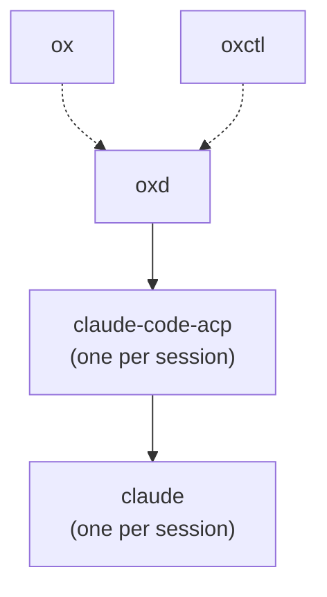

# Architecture

Ox runs as a tree of processes. The desktop app and `oxctl` are clients of
`oxd`, a per-user daemon that owns every session's agent process. Sessions
outlive the clients that started them, so closing and reopening the app
reconnects to the same sessions. `oxd` also saves its workspaces and sessions,
so they outlive the daemon.

Solid arrows point from a parent to the processes it owns. Dotted arrows
start `oxd` detached, so it outlives the client that started it.

## What belongs in oxd

`oxd` owns shared state and shared work:

- everything persisted;
- everything that every client must see kept up to date;
- anything long-running, or anything that has to complete or be undone even
  if the client goes away;
- every write to a repository.

Clients hold presentation and choose the parameters. `oxd`'s operations are
generic: it never decides which ref, which branch name, or which order of
steps. Those choices make up a workflow, and workflows belong to the clients.

## Processes

**ox.** The Tauri 2 desktop app. The React UI in the webview calls Tauri commands
in the Rust core, which forwards them to `oxd` through one
`ox_protocol::Client` and streams the workspaces and sessions lists and the
open session's conversation back over Tauri channels. The sidebar groups
sessions under their workspaces; a workspace is added by choosing a directory.
A workspace's New Session menu opens beside its button with an agent select
above **Existing Checkout**,
which runs the session in the workspace's directory, and, in a Git working
tree, **New Worktree**, on a new branch, **New Worktree on Existing
Branch…**, and **New Worktree on New Branch…**. The existing-branch dialog
picks from the local branches, showing each one a worktree has checked out
with that worktree and not offering it, and the remote branches with no local
branch of the same name. The new-branch dialog asks for a name, noting one a
local or remote branch has, and the commit it starts from. Both dialogs list
the workspace's branches at once, then again once a fetch of its remotes
answers, and note a failed fetch. Selecting a saved session whose
agent is not running loads it. A new session runs `claude-code-acp` from
beside the app's executable. The app passes its environment to the session
and to every request that runs git. **Delete Session** asks before discarding
a worktree's unsaved work, says which branch `oxd` kept, and counts a session
that is already gone as deleted. The app's dialogs are in-window `<dialog>`
elements; errors show in a native message box.

**oxctl.** A command-line client of `oxd` that speaks the same protocol as
the app. `oxctl new --worktree` starts a session in a new worktree on its own
branch, `--branch` in one on an existing branch, and `--new-branch` in one on
a new branch started at `--start`. `oxctl delete` deletes a
session, and with `--discard` gives up its worktree's unsaved work; it prints
the branch it kept, if any. `oxctl archive` archives a session, with
`--discard` as for delete, and `oxctl unarchive` undoes it; `oxctl ls` shows
`archived` in place of an archived session's state. `oxctl attach` prints an
elicitation's fields, and `oxctl answer` accepts it with its content as a JSON
object, or declines or cancels it with `--decline` or `--cancel`.

**oxd.** A per-user daemon on `$OX_SOCKET`, or `oxd.sock` in Ox's data
directory: `$XDG_DATA_HOME/ox` when `XDG_DATA_HOME` is an absolute path, else
`~/.local/share/ox`.
`Client::connect_or_start` starts `oxd` from beside the client's executable
when no daemon answers, in a new session (`setsid`) with stderr appended to
`oxd.log` beside the socket, and reads the `ready` line it prints once a
daemon is listening. A startup lock and an instance lock keep one daemon per
socket. `oxd` accepts connections only from its own user, and exits after an
idle period with no clients and no running agents; a session whose agent has
exited is saved and does not keep `oxd` alive. Each session runs its agent
command in its own process group and speaks ACP to it over stdio; closing the
session kills that group.

`oxd` speaks draft ACP protocol v2 to its agents; [`acp-v2.md`](acp-v2.md)
charts its support. A turn starts and ends on the agent's `state_update`
session updates, whether a prompt or the agent started it. A prompt makes the
session running at once and records `prompt_started`; `running`,
`requires_action`, and a state `oxd` does not know start a turn the agent
began by itself, recorded as `turn_started`. The agent's `idle` ends the
turn, recorded as `turn_ended` with the stop reason it reports, and `oxd`
takes no prompt until then. After a prompt, only an `idle` that follows the
agent reporting work ends the turn, since the agent may repeat an idle
snapshot first. The agent answers `session/prompt` when it inserts the
prompt; an error answer means it did not, and ends the turn with that error
unless the agent already reported work for the prompt. `oxd` opens a session
only with an agent that advertises `sessionCapabilities`.

`oxd` records an agent's permission requests and form elicitations as
session events and relays clients' answers. A session with an open
permission request is `awaiting_permission`; one with only an open
elicitation is `awaiting_input`. Both kinds of request take their IDs from one
sequence per session. Cancelling the turn cancels open permission requests;
an elicitation stays open until a client answers it or the agent withdraws it
with `$/cancel_request`. When the agent exits or the session is parked or
closed, every open request ends cancelled.

**Workspaces and saved sessions.** A workspace is a directory the user
added. A session belongs to a workspace by ID and runs in the workspace's
directory or in a worktree of it, a directory the session stores
separately. `workspace.remove` is refused
while any session, exited ones included, belongs to the workspace. `oxd`
saves workspaces and sessions in one SQLite database beside the socket,
`<socket>.db`, and is the only process that writes it. A session's row holds
its workspace, command, directory, title, and the agent's session ID, and is
written when the session is created and again when its title or agent session
ID changes. The database holds no environment variables: a client passes its
environment each time it starts an agent, with `session.new` and
`session.load`. The schema has no migrations.

**Event log.** `oxd` stores every event a session records, except
`session_closed`, in the database's `events` table, keyed by session and
`seq`, as the event's JSON. A thread of its own writes them, batching whatever
is queued into one transaction, so recording an event never waits on SQLite;
`oxd` flushes the queue on shutdown, and events still queued when it is killed
are lost. The database runs in WAL mode with `synchronous = NORMAL`. A restored
session knows its last `seq` from the table and reads its events the first
time a client subscribes to it or loads it. Reading closes what a stop left
open: a turn without a `turn_ended` ends with the error "oxd stopped during
the turn", and a permission request or elicitation without a resolution is
cancelled. Request IDs continue after the largest in the log. So every
session's history, with its original `seq`s, survives `oxd` restarts and does
not need an agent or Claude's transcript. Deleting a session deletes its
events.

The database keeps every session's full history, tool output and images
included, until the session is deleted. Continuing a conversation still needs
Claude's transcript, so a session older than Claude's `cleanupPeriodDays`
(default 30 days,
https://code.claude.com/docs/en/data-usage#data-retention) can be read but
cannot resume.

**Worktrees.** `session.new` takes a `checkout`: the workspace's directory, or
a new worktree of the workspace's Git repository. `oxd` runs every Git
operation as the `git` CLI, with the client's environment over its own and
without the variables that point git at one repository (`GIT_DIR` and the
rest of `git rev-parse --local-env-vars`). The request says which branch the
worktree is on: none, an existing branch, or a new one. A worktree's branch
is one of three kinds:

- **New**: with no branch, `ox/<first 8 digits of the session ID>` from
  `HEAD`, or a new branch the request names, which starts at its `start`, or
  `HEAD`, and is refused when a local branch, a remote branch's full name, or
  a branch on any remote has the name. It has no upstream.
- **Existing**: an existing local branch, which is refused while any worktree
  has it checked out.
- **Track**: an existing branch found only on a remote, as `<branch>` or
  `<remote>/<branch>`, which becomes a local branch tracking it. A name on
  several remotes takes the one `checkout.defaultRemote` names, and is
  otherwise refused.

An existing branch that is neither local nor on a remote is refused. The
worktree is
`worktrees/<checkout name>-<first 8 digits of the session ID>` beside the
socket, where the checkout name is the final component of the top level of
the workspace's checkout, and the session runs in the same subdirectory of
it that the workspace is of its checkout. It holds committed files only;
uncommitted changes stay in the workspace, and `oxd` writes nothing into the
repository but the worktree's administrative files and the branch.

Creation has two phases. Before answering, `oxd` resolves and checks the
branch, refuses a worktree directory that already exists, creates a new or
tracking branch with `git branch`, which fails if the branch exists, and
saves the session's row and its `worktrees` row (path, branch, the commit
it started at, whether `oxd` created the branch, and the repository's
absolute common Git directory) in one transaction. Any
failure there answers with an error and leaves nothing behind. The answer is
the session in `starting`. The session's startup then runs `git worktree
add` and launches the agent in the worktree. If the worktree cannot be added,
`oxd` removes what git left, deletes a branch it created if the branch still
points where it started, and forgets the worktree; the session is `exited`
with git's error and, never having started, is deleted at the next start of
`oxd`. `workspace.remove` is refused while the database has a session row for
the workspace, which covers a session being created. `session.load` refuses
a session whose directory no longer exists.

`session.delete` deletes a session. For a session in a worktree it first
waits for the session's startup to finish; a load or another delete of the
session waits for it in turn. Unless the request sets `discard`, it refuses
with `UNSAVED_WORK`, listing what would be lost and leaving the session as it
was, while the worktree has uncommitted changes (`git status`, untracked
files included, ignored files not), commits on no branch, remote branch or
tag, or an initialized submodule has commits on no remote branch. It also
refuses while git cannot use the worktree, so that nothing can be checked:
its repository is gone, or the repository no longer knows the worktree. It
then stops the agent and waits for its task to end, and removes the
worktree, ignored files included, with `git worktree remove --force`. A
worktree git cannot use is deleted as a directory, which `oxd` owns, and a
worktree directory deleted outside Ox is unregistered from the repository.
Last it applies the branch rule: a branch `oxd` created is deleted, at the
tip it read, when every commit on it since the session's starting commit is
on another branch, a remote branch or a tag, and no worktree has it checked
out. Otherwise the branch is kept and named in the answer's `kept_branch`,
as it is when the repository is gone and the branch cannot be checked. A
branch that existed before the session is never deleted. Removal and the
branch rule run git in the recorded common Git directory with `--git-dir`
set to it, and the unsaved checks run in the worktree, so none of them
depends on the workspace's directory still existing. If work appears
after the check, or git fails, such as on a locked worktree, the delete
answers the error and the session stays `exited` and loadable. Deleting a
session not in a worktree stops its agent and deletes its row.

Each workspace `oxd` sends carries `git_working_tree`, which says whether to
offer worktrees for it. `oxd` works it out from the filesystem each time it
builds the lists, without running git: it is true when no component of the
workspace's path is `.git` and the path or one of its parents has a `.git`
entry. A `git init` therefore shows in the next lists `oxd` sends, on the
next session change or client connection. `workspace.branches` answers the
local and remote-tracking branches of a workspace's repository, each most
recently committed first, without symbolic refs such as `origin/HEAD`, with
the worktree that has each local branch checked out.
`workspace.branches` and `session.new` with a worktree refuse a workspace
git finds in no working tree, including one whose `.git` git rejects, with
git's reason in the message. With `fetch`, `oxd` first runs `git
fetch --all`, which follows the user's prune settings. Requests for one
repository, keyed by its common Git directory, share the fetch running for
it, which uses the environment of the request that started it and runs in a
task of its own. A fetch runs in its own process group and is sent
`SIGTERM` after 60 seconds. A fetch that fails or is stopped is reported in
`fetch_error`, beside the lists as they stand. Session creation never waits
on a fetch.

Shutdown on SIGTERM, SIGINT, or idle exit kills the agents and keeps every
row. When `oxd` starts it registers each saved session in state `exited`,
with no agent and no events, and deletes the sessions that never started,
which have no agent session ID to load, and have no worktree. After it
reports `ready`, a background task cleans up those that never started in a
worktree, one at a time, holding each one's lifecycle lock, so that a load
or delete of it waits. It removes the worktree and applies the branch rule
with `oxd`'s own environment, as a delete without `discard` does, and then
deletes the session. A session whose worktree would lose work, or cannot be
removed, is kept as `exited`, with the reason in `oxd`'s log, and can only
be deleted. `oxd` does not idle-exit while this runs, and a shutdown does
not wait for it; sessions it has not reached are cleaned up at the next
start.
**Parking.** `oxd` stops the agent of a session that has stayed parkable for
the park delay, `--park-after-ms` (default 15 minutes), without a break. A
session is parkable when its agent is idle, no request is pending,
the agent last reported no background work (`background` is `[]`; an agent
that reports none never parks), and no client subscribes to the session; a
watch is not a subscription. Any change that ends one of these restarts the
delay. A parked session keeps its conversation, worktree, and branch, records
`agent_parked`, and is `exited`; no subscription ends. `session.load` wakes
it, as it does any exited session. Parking holds the session's lifecycle lock,
so a load, delete, or startup in progress finishes first.

**Archiving.** `session.archive` waits for the session's startup to finish,
refuses with `UNSAVED_WORK` as `session.delete` does unless `discard` is set,
stops the agent (ending an open turn and pending requests with the
error "the agent was stopped", and recording `agent_parked`), removes the
worktree, and marks the session archived in the `archived` table. The branch is
always kept and the branch rule is not applied. The session is `exited` with
`SessionInfo.archived` true; subscribing to it delivers its stored history
with no agent, and `session.load` refuses it. A refusal or git failure leaves
the session not archived. `session.unarchive` runs `git worktree add <path>
<branch>` in the recorded repository, answering `GIT` and leaving the session
archived if git refuses, such as for a deleted branch or one checked out
elsewhere, then clears the mark. The session is then an ordinary `exited`
session that `session.load` resumes, from Claude's transcript. `session.delete`
deletes an archived session as any other.

`session.load` restarts the agent of an exited session that has an agent
session ID, from the session's stored command and directory, on the same
session: the session ID, subscriptions, and sidebar selection stay the same,
and the session goes through `starting` to `idle` as a new one does. The agent
replays the conversation, then reports its state, before it answers
`session/resume` with `replayFrom: start`. An agent that reports it is working
leaves the session `running` until its `idle`, with no `turn_started` or
`turn_ended` for work the history did not see start. A session whose
agent has not started yet, or has no stored events, records the replay as
its history once the agent starts, so a load that fails partway records none
of it; one whose agent has started, such as one that crashed or was
restored from the database, keeps its history and drops the replay, and its history shows a second `agent_started` after the
`agent_exited`.

**claude-code-acp.** An ACP agent, speaking draft protocol v2, that bridges to
the Claude Code CLI. [`acp-v2.md`](acp-v2.md) charts its support of the
protocol. Opening a session answers at once with the session's settings, then
starts and initializes one `claude -p`, in the bridge's process group, whose
commands follow as an update; a `claude` that fails to start fails the next
prompt with its error. The session keeps that process: the bridge holds its stdin open,
writes each prompt to it as a stream-json message, reads streamed output and
permission requests from its stdout, and answers permission requests with the
client's decision. A prompt is answered when Claude takes it into a turn: the
bridge sends it as a user message and answers with that message's ID. The
turn's output, and its end as a `state_update` of `idle` with a stop reason,
arrive as updates. A subagent's tool calls show as lines of the content of
the tool call that started it, and a tool call's result as its content.
`session/cancel` interrupts the running turn, and a model or mode change goes
to the running process as a control request. Claude keeps running between
prompts, and the turns it starts by itself, when a background task reports
back, stream to the client as a prompt's turn does. When `claude` has exited,
the next prompt starts another with `--resume` and the Claude session ID.
`session/close` stops `claude`. The bridge records its sessions in
`acp-sessions.json` and replays Claude's transcripts on `session/resume` with
`replayFrom: start`.

**claude.** The Claude Code CLI, authenticated with the user's subscription.
