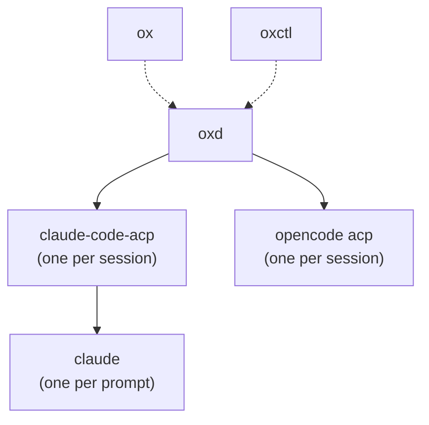

# Architecture

Ox runs as a tree of processes. The desktop app and `oxctl` are clients of
`oxd`, a per-user daemon that owns every session's agent process. Sessions
outlive the clients that started them, so closing and reopening the app
reconnects to the same sessions.

Solid arrows point from a parent to the processes it owns. Dotted arrows
start `oxd` detached, so it outlives the client that started it.

## Processes

**ox.** The Tauri 2 desktop app. The React UI in the webview calls Tauri commands
in the Rust core, which forwards them to `oxd` through one
`ox_protocol::Client` and streams the sessions list and the open session's
conversation back over Tauri channels. A new Claude session runs
`claude-code-acp` from beside the app's executable; a new OpenCode session
runs `opencode acp`. The app passes its environment to the session.

**oxctl.** A command-line client of `oxd` that speaks the same protocol as
the app.

**oxd.** A per-user daemon on `$OX_SOCKET`, or `<data dir>/ox/oxd.sock`.
`Client::connect_or_start` starts `oxd` from beside the client's executable
when no daemon answers, in a new session (`setsid`) with stderr appended to
`oxd.log` beside the socket, and reads the `ready` line it prints once a
daemon is listening. A startup lock and an instance lock keep one daemon per
socket. `oxd` accepts connections only from its own user, and exits after an
idle period with no clients and no sessions. Each session runs its agent
command in its own process group and speaks ACP to it over stdio; closing the
session kills that group.

**claude-code-acp.** An ACP agent that bridges to the Claude Code CLI. Each
prompt runs `claude -p` in its own process group, writes the prompt to its
stdin as stream-json, reads streamed output and permission requests from its
stdout, and answers permission requests with the client's decision. A later
prompt passes `--resume` with the Claude session ID to continue the
conversation. The bridge records its sessions in `acp-sessions.json` and
replays Claude's transcripts on `session/load`.

**claude.** The Claude Code CLI, authenticated with the user's subscription.
