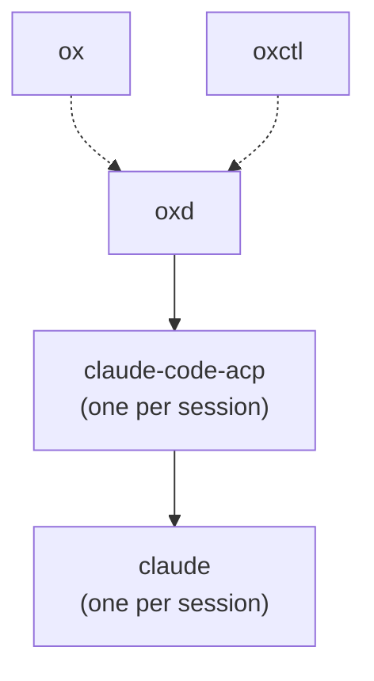

# Architecture

Ox runs as a tree of processes. The desktop app and `oxctl` are clients of
`oxd`, a per-user daemon that owns every session's agent process. Sessions
outlive the clients that started them, so closing and reopening the app
reconnects to the same sessions. `oxd` also saves its workspaces and sessions,
so they outlive the daemon.

Solid arrows point from a parent to the processes it owns. Dotted arrows
start `oxd` detached, so it outlives the client that started it.

## Processes

**ox.** The Tauri 2 desktop app. The React UI in the webview calls Tauri commands
in the Rust core, which forwards them to `oxd` through one
`ox_protocol::Client` and streams the workspaces and sessions lists and the
open session's conversation back over Tauri channels. The sidebar groups
sessions under their workspaces; a workspace is added by choosing a directory,
and a session starts in a workspace without asking for one. Selecting a saved
session whose agent is not running loads it. A new session runs
`claude-code-acp` from beside the app's executable. The app passes its
environment to the session.

**oxctl.** A command-line client of `oxd` that speaks the same protocol as
the app.

**oxd.** A per-user daemon on `$OX_SOCKET`, or `oxd.sock` in Ox's data
directory: `$XDG_DATA_HOME/ox` when `XDG_DATA_HOME` is an absolute path, else
`~/.local/share/ox`.
`Client::connect_or_start` starts `oxd` from beside the client's executable
when no daemon answers, in a new session (`setsid`) with stderr appended to
`oxd.log` beside the socket, and reads the `ready` line it prints once a
daemon is listening. A startup lock and an instance lock keep one daemon per
socket. `oxd` accepts connections only from its own user, and exits after an
idle period with no clients and no running agents; a session whose agent has
exited is saved and does not keep `oxd` alive. Each session runs its agent
command in its own process group and speaks ACP to it over stdio; closing the
session kills that group.

`oxd` speaks draft ACP protocol v2 to its agents; [`acp-v2.md`](acp-v2.md)
charts its support. A turn starts and ends on the agent's `state_update`
session updates, whether a prompt or the agent started it. A prompt makes the
session running at once and records `prompt_started`; `running`,
`requires_action`, and a state `oxd` does not know start a turn the agent
began by itself, recorded as `turn_started`. The agent's `idle` ends the
turn, recorded as `turn_ended` with the stop reason it reports, and `oxd`
takes no prompt until then. After a prompt, only an `idle` that follows the
agent reporting work ends the turn, since the agent may repeat an idle
snapshot first. The agent answers `session/prompt` when it inserts the
prompt; an error answer means it did not, and ends the turn with that error
unless the agent already reported work for the prompt. `oxd` opens a session
only with an agent that advertises `sessionCapabilities`.

**Workspaces and saved sessions.** A workspace is a directory the user
added. A session belongs to a workspace by ID and runs in the workspace's
directory, which the session stores separately. `workspace.remove` is refused
while any session, exited ones included, belongs to the workspace. `oxd`
saves workspaces and sessions in one SQLite database beside the socket,
`<socket>.db`, and is the only process that writes it. A session's row holds
its workspace, command, directory, title, and the agent's session ID, and is
written when the session is created and again when its title or agent session
ID changes. The database holds no environment variables: a client passes its
environment each time it starts an agent, with `session.new` and
`session.load`. The schema has no migrations.

`session.close` deletes the session's row. Shutdown on SIGTERM, SIGINT, or idle
exit kills the agents and keeps every row. When `oxd` starts it registers each
saved session in state `exited`, with no agent and no events, and deletes
those that never started, which have no agent session ID to load.
`session.load` restarts the agent of an exited session that has an agent
session ID, from the session's stored command and directory, on the same
session: the session ID, subscriptions, and sidebar selection stay the same,
and the session goes through `starting` to `idle` as a new one does. The agent
replays the conversation, then reports its state, before it answers
`session/resume` with `replayFrom: start`. An agent that reports it is working
leaves the session `running` until its `idle`, with no `turn_started` or
`turn_ended` for work the history did not see start. A session whose
agent has not started yet records the replay as its history once the agent
starts, so a load that fails partway records none of it; one whose agent
has started, such as one that crashed, keeps its history and drops the
replay, and its history shows a second `agent_started` after the
`agent_exited`.

**claude-code-acp.** An ACP agent, speaking draft protocol v2, that bridges to
the Claude Code CLI. [`acp-v2.md`](acp-v2.md) charts its support of the
protocol. A session's first prompt starts one `claude -p`, in the bridge's
process group, and the session keeps it: the bridge holds its stdin open,
writes each prompt to it as a stream-json message, reads streamed output and
permission requests from its stdout, and answers permission requests with the
client's decision. A prompt is answered when Claude takes it into a turn: the
bridge sends it as a user message and answers with that message's ID. The
turn's output, and its end as a `state_update` of `idle` with a stop reason,
arrive as updates. A subagent's tool calls show as lines of the content of
the tool call that started it, and a tool call's result as its content.
`session/cancel` interrupts the running turn, and a model or mode change goes
to the running process as a control request. Claude keeps running between
prompts, and the turns it starts by itself, when a background task reports
back, stream to the client as a prompt's turn does. When `claude` has exited,
the next prompt starts another with `--resume` and the Claude session ID.
`session/close` stops `claude`. The bridge records its sessions in
`acp-sessions.json` and replays Claude's transcripts on `session/resume` with
`replayFrom: start`.

**claude.** The Claude Code CLI, authenticated with the user's subscription.
