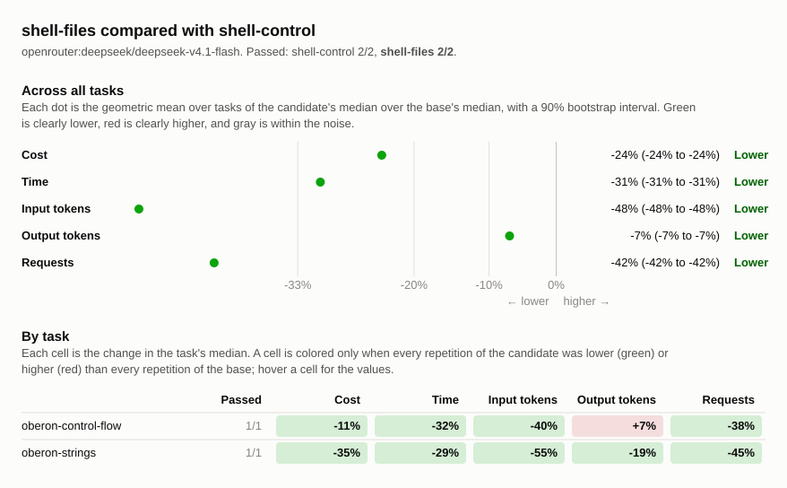

# Evaluation comparison: shell-control, shell-files

## Runs

| Label         | Commit       | Dirty | Model                                     | Effort  | Providers | Results |
| ------------- | ------------ | ----- | ----------------------------------------- | ------- | --------- | ------- |
| shell-control | `e4da234711` | no    | `openrouter:deepseek/deepseek-v4.1-flash` | default | deepseek  | 2       |
| shell-files   | `e4da234711` | yes   | `openrouter:deepseek/deepseek-v4.1-flash` | default | deepseek  | 2       |

## Chart

## Summary

Changes are relative to `shell-control`. A task's values are medians over its
repetitions, with the range in parentheses. Totals are sums of task medians.

| Metric            | shell-control | shell-files | Change |
| ----------------- | ------------: | ----------: | -----: |
| finished          |           2/2 |         2/2 |        |
| passed            |           2/2 |         2/2 |        |
| seconds           |          1254 |         870 |   -31% |
| requests          |           252 |         145 |   -42% |
| tool_calls        |           266 |         166 |   -38% |
| failed_calls      |            24 |           4 |   -83% |
| cancelled_calls   |             0 |           0 |        |
| repeated_calls    |             3 |           0 |  -100% |
| input_tokens      |      32811065 |    15872641 |   -52% |
| cached_tokens     |      32576128 |    15668096 |   -52% |
| output_tokens     |        163434 |      147734 |   -10% |
| reasoning_tokens  |         98962 |       88587 |   -10% |
| cost              |       $0.4621 |     $0.3327 |   -28% |
| max_input_tokens  |        361393 |      332118 |    -8% |
| tool_output_chars |        669324 |      674425 |    +1% |

### Passed and cost by task

| Task                  | shell-control passed | shell-files passed | shell-control cost | shell-files cost | Change |
| --------------------- | -------------------: | -----------------: | -----------------: | ---------------: | -----: |
| `oberon-control-flow` |                  1/1 |                1/1 |            $0.1355 |          $0.1208 |   -11% |
| `oberon-strings`      |                  1/1 |                1/1 |            $0.3266 |          $0.2119 |   -35% |

## Tasks

### `oberon-control-flow`

| Metric               | shell-control | shell-files | Change |
| -------------------- | ------------: | ----------: | -----: |
| status               |    finished 1 |  finished 1 |        |
| passed               |           1/1 |         1/1 |        |
| seconds              |           499 |         337 |   -32% |
| requests             |            90 |          56 |   -38% |
| tool_calls           |            99 |          65 |   -34% |
| failed_calls         |             8 |           3 |   -62% |
| cancelled_calls      |             0 |           0 |        |
| `apply_patch` calls  |            35 |           0 |  -100% |
| `apply_patch` failed |             4 |           0 |  -100% |
| `read_file` calls    |            15 |           0 |  -100% |
| `read_file` failed   |             0 |           0 |        |
| `shell` calls        |            49 |          65 |   +33% |
| `shell` failed       |             4 |           3 |   -25% |
| repeated_calls       |             1 |           0 |  -100% |
| input_tokens         |       7022319 |     4181565 |   -40% |
| cached_tokens        |       6948608 |     4115584 |   -41% |
| output_tokens        |         59707 |       63588 |    +7% |
| reasoning_tokens     |         33691 |       39058 |   +16% |
| cost                 |       $0.1355 |     $0.1208 |   -11% |
| max_input_tokens     |        121932 |      122674 |    +1% |
| tool_output_chars    |        195273 |      211522 |    +8% |

### `oberon-strings`

| Metric               | shell-control | shell-files | Change |
| -------------------- | ------------: | ----------: | -----: |
| status               |    finished 1 |  finished 1 |        |
| passed               |           1/1 |         1/1 |        |
| seconds              |           756 |         533 |   -29% |
| requests             |           162 |          89 |   -45% |
| tool_calls           |           167 |         101 |   -40% |
| failed_calls         |            16 |           1 |   -94% |
| cancelled_calls      |             0 |           0 |        |
| `apply_patch` calls  |            72 |           0 |  -100% |
| `apply_patch` failed |            16 |           0 |  -100% |
| `read_file` calls    |            16 |           0 |  -100% |
| `read_file` failed   |             0 |           0 |        |
| `shell` calls        |            79 |         101 |   +28% |
| `shell` failed       |             0 |           1 |        |
| repeated_calls       |             2 |           0 |  -100% |
| input_tokens         |      25788746 |    11691076 |   -55% |
| cached_tokens        |      25627520 |    11552512 |   -55% |
| output_tokens        |        103727 |       84146 |   -19% |
| reasoning_tokens     |         65271 |       49529 |   -24% |
| cost                 |       $0.3266 |     $0.2119 |   -35% |
| max_input_tokens     |        239461 |      209444 |   -13% |
| tool_output_chars    |        474051 |      462903 |    -2% |
